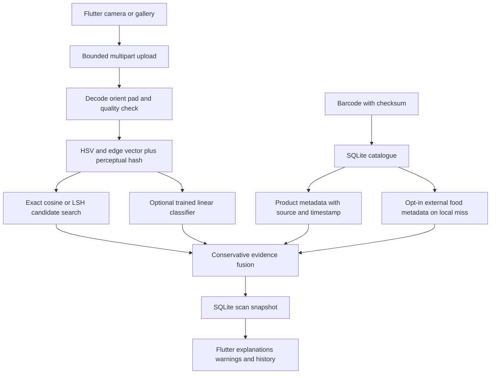

# Architecture guide

SafeScan retrieves evidence through two independent routes: visual nearest-reference matching and barcode-linked structured metadata. Their outputs remain separate so a visual candidate is never presented as a confirmed product identity.

## Backend responsibilities

`main.py` owns HTTP validation and routes. Application lifespan initializes `ScanService`, which owns settings, SQLite and a single immutable classifier instance. CPU-bound HTTP work runs in FastAPI worker threads; the upload route delegates preprocessing to a thread. SQLite uses a new connection per operation with foreign keys, parameter binding, transactions and a busy timeout. HTTP upload names never become filesystem paths; generated UUIDs select canonical, metadata-free PNGs.

`vision.py` defines the shared versioned preprocessing contract. Images become RGB, receive EXIF correction and neutral padding to 224 × 224. OpenCV computes grayscale/blur/edges, a normalized 16 × 8 HSV histogram, an 8 × 8 edge grid and a 64-bit DCT perceptual hash. The 192-dimensional vector is L2-normalized. pHash distance is displayed as corroborating appearance evidence; ranking uses cosine similarity.

`algorithms.py` implements heap-based exact top-k search and random-hyperplane LSH. LSH can miss neighbors, including all candidates. The API does not silently substitute exact results. The current service loads reference vectors and constructs an LSH index on each request. It is a small-catalogue baseline; claims about millions of products or subsecond production scale require a persistent index and measured benchmarks.

`model.py` loads numeric `.npz` weights with `allow_pickle=False`, checks dimensions, finite values, label order and feature version, and reports missing/corrupt artifacts as unavailable. The classifier is regularized, class-weighted logistic regression trained by full-batch gradient descent. It uses the same deterministic image features as search. This provides a runnable baseline without pretrained downloads. It cannot resolve microscopic security markings or establish manufacturing origin.

## Evidence policy

The default outcome is `Unknown / Insufficient Evidence`. Non-unknown labels require an explicitly enabled policy, an available model, confidence ≥ 0.90, nearest-reference similarity ≥ 0.90, agreement between model/reference labels, no image quality warnings and no supplied-barcode mismatch. The cutoffs are engineering defaults, not experimentally calibrated safety guarantees. Missing evidence never becomes confidence zero, a negative recall finding, or certification.

`metadata` is barcode-associated; `visual_candidate_metadata` is explicitly an unconfirmed image candidate. Safety records carry product id and association, original source URL, scope, jurisdiction and checked timestamp. A record's presence does not establish that the scanned batch falls within its scope. Imported records require human provenance review; schema validation cannot establish source truth. No claims are derived from appearance, brand reputation, barcode prefix, external catalogue label tags or absence of records.

## Storage and operations

The SQLite entities are `products`, `uploads`, `reference_images` and `scans`. Product records contain source-qualified evidence. References link products and image uploads with label, source, feature version, vector and pHash. History stores the evidence snapshot at scan time; catalogue updates do not rewrite earlier results. The model loads on API startup. Imports use a local CLI, not an unauthenticated write-product endpoint.

This is a local single-user research service. History and uploaded images are shared by everyone who can reach that backend. Authentication, user isolation, TLS termination, rate limits, retention controls, reverse-proxy request limits, audit logging and migrations are production work. No CORS wildcard is configured and the Flutter web target is not validated. Do not expose the prototype on the public internet. Normal launch binds to a trusted LAN only when phone access is needed.

The external adapter is opt-in and queries only a fixed Open Food Facts host with a short timeout and no redirects. It sends the barcode, never the uploaded image, and returns catalogue data without safety claims. Network failures preserve local operation. A government recall API and certification-registry integration are not implemented; sourced records can be imported manually.
